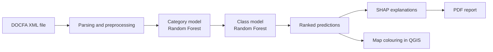

<a id="top"></a>

# Public AI Challenge: AI-Assisted Cadastral Classification

<p align="center">
  
  <a href="https://github.com/jagorev/PublicAIChallenge/graphs/contributors"></a>
  
  
</p>

<p align="center">
  
  
  
  
</p>

> A machine-learning assistant for cadastral operators. It predicts the **category** and **class** of a real-estate unit from its DOCFA filing, explains each prediction, and shows the result directly on the map inside QGIS.

Built for the [Public AI Challenge](https://www.trentinoinnovation.eu/innova/strumenti-per-innovazione/public-ai-challenge/) organised by HIT (Trentino Innovation), by a team of six students.

<details>
<summary><h2>Table of Contents 📖</h2></summary>

- [Overview](#overview)
- [How it works](#how-it-works)
- [Key features](#key-features)
- [The model](#the-model)
- [The QGIS plugin](#the-qgis-plugin)
- [Repository structure](#repository-structure)
- [Getting started](#getting-started)
- [Team](#team)
- [Acknowledgments](#acknowledgments)

</details>

## Overview

Cadastral operators have to assign a **category** and a **class** to every new real-estate unit. The challenge asked for a system that supports this work with machine learning, without leaving the tools operators already use.

The project has two goals:

1. **Automated prediction.** Train a model that predicts the cadastral category and class of a new unit from the description in its filing.
2. **QGIS integration.** Ship the model as a Python plugin for QGIS 3, so operators can run it and read the result in their normal workflow.

## How it works



1. The operator selects a DOCFA XML file.
2. The plugin parses it and builds the same features used in training.
3. A first model predicts the **category**; a second model predicts the **class** within it.
4. Predictions are ranked by probability and coloured on the parcels layer.
5. SHAP values show which features drove the prediction, and a PDF report can be generated.

## Key features

- Two-stage prediction: category first, then class within the category.
- Class weighting, grouping of very rare categories and classes, and simple data augmentation for under-represented classes.
- Local explanations with SHAP for every prediction.
- Map colouring in QGIS: the top two predicted categories are coloured green and orange, with opacity based on the model's probability. The original style can be restored with one click.
- One-click PDF report with predictions and explanation charts.

## The model

The training pipeline is in [`Gruppo_Dati/classamento_pipeline.py`](Gruppo_Dati/classamento_pipeline.py), with step-by-step notebooks in [`Gruppo_Dati/notebooks_elaborazione_dati`](Gruppo_Dati/notebooks_elaborazione_dati).

- **Data:** cadastral records and DOCFA XML filings provided by the challenge organisers. They are not included in this repository.
- **Models:** two scikit-learn Random Forest classifiers (category, then class).
- **Imbalance handling:** balanced class weights with extra weight on rare classes, grouping of rare categories and classes, and augmentation of classes with few examples.
- **Evaluation:** accuracy, classification reports and confusion-matrix analysis on a held-out test set.
- **Inference:** notebooks and scripts in [`Gruppo_Dati/inferenza`](Gruppo_Dati/inferenza) run the models on one or more XML files and build the report.

## The QGIS plugin

The plugin lives in [`Gruppo_QGIS/Plugin_Classamento_Immobiliare_AI`](Gruppo_QGIS/Plugin_Classamento_Immobiliare_AI).

| Module | Role |
| --- | --- |
| `colorazione_classi.py` | Plugin entry point: file selection, running the inference, colouring and resetting the layer |
| `model_inference.py` | Loads the models, parses the XML, predicts category and class, computes SHAP explanations |
| `prediction_dialog.py` | Dialog with the ranked predictions, the explanation and the apply, reset and report buttons |
| `report_generator.py` | Builds the PDF report with ReportLab and the SHAP charts |

The earlier plugin prototypes are kept in [`Gruppo_QGIS/Prime implementazioni`](Gruppo_QGIS/Prime%20implementazioni).

## Repository structure

```text
.
+-- Gruppo_Dati/
|   +-- classamento_pipeline.py          # preprocessing, training, evaluation
|   +-- notebooks_elaborazione_dati/     # data preparation and pipeline notebooks
|   +-- inferenza/                       # inference notebooks and report script
|   `-- requirements.txt
+-- Gruppo_QGIS/
|   +-- Plugin_Classamento_Immobiliare_AI/   # final plugin
|   `-- Prime implementazioni/               # earlier prototypes
`-- demo_plugin/                         # first plugin demo
```

## Getting started

### Train and test the models

```bash
pip install -r Gruppo_Dati/requirements.txt
```

Then follow the notebooks in `Gruppo_Dati/notebooks_elaborazione_dati` or run `classamento_pipeline.py`. You need the cadastral dataset from the challenge.

### Install the plugin in QGIS

1. Copy `Gruppo_QGIS/Plugin_Classamento_Immobiliare_AI` into your QGIS plugins folder (*Settings → User Profiles → Open Active Profile Folder → `python/plugins`*).
2. Install the dependencies in the Python environment used by QGIS:

   ```bash
   pip install pandas numpy scikit-learn matplotlib reportlab shap joblib
   ```

3. Put the trained model files in a `data/` folder inside the plugin: `model_categoria.pkl`, `model_classe.pkl`, `label_encoders_final.pkl`, `numeric_medians.pkl` and `column_types.pkl`. These files are produced by the training pipeline and are not versioned because of their size.
4. Enable the plugin in QGIS, load a parcels layer with a `CATEGORIA` attribute, and select a DOCFA XML file.

## Team

| Member | GitHub |
| --- | --- |
| Kuba Di Quattro | [@KubaD4](https://github.com/KubaD4) |
| Decebal Cernei | [@decebalcernei](https://github.com/decebalcernei) |
| Jago Revrenna | [@jagorev](https://github.com/jagorev) |
| Michele Minniti | n/a |
| Francesco Datres | n/a |
| Guillermo Torrealba | n/a |

The team worked in two groups: a data group (model, pipeline, inference) and a QGIS group (plugin and integration).

## Acknowledgments

Thanks to HIT (Hub Innovazione Trentino) and the organisers of the Public AI Challenge for the challenge.

<p align="center">
  <a href="#top" style="text-decoration: none;">
    
    <br>
    <strong>Back to Top</strong>
  </a>
</p>
